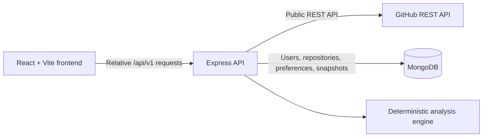

# DevFlow

**Understand your repositories. Identify risks. Make better engineering decisions.**

DevFlow analyzes public GitHub repositories, computes an explainable repository health heuristic, identifies stale issues and pull requests, and stores analysis snapshots in MongoDB. The score is a DevFlow-defined heuristic. It is not an official GitHub metric or a measure of code quality.

## Features

- Register, log in, and log out with an HttpOnly session cookie.
- Search for public GitHub repositories and save repositories to a personal workspace.
- Analyze repository activity and store a report for later review.
- Browse current GitHub issues and pull requests with search, state, stale, label, threshold, and pagination controls.
- View score component explanations, rule-based recommendations, and stored analysis history.
- Configure issue and pull request inactivity thresholds.
- Show data source, fetch time, bounded-observation warnings, and missing-data states instead of treating unavailable values as zero.

## Architecture



The frontend never connects directly to MongoDB. `backend/services/githubService.js` is the only module that makes GitHub HTTP requests. The analysis engine is deterministic and receives its current time as an input. MongoDB stores compact analysis snapshots, not raw GitHub responses. Current issue and pull request pages use live or cached GitHub data; history pages use stored snapshots and do not recompute old reports.

## Repository structure

- `frontend/`: React, Vite, React Router, Lucide icons, plain CSS, and RTL tests.
- `backend/`: Express API, Mongoose models, GitHub service, analysis engine, validators, and Supertest/Vitest tests.
- `SPEC.md`: full project requirements and implementation decisions.

## Health score

Each available component is scored from 0 to 100 and weighted as follows:

| Component | Weight | Calculation |
| --- | ---: | --- |
| Commit activity | 0.30 | `min(100, round(commits30d / 20 * 100))` |
| Issue management | 0.25 | `100 * (1 - staleOpenIssues / observedOpenIssues)` |
| Pull request management | 0.25 | `100 * (1 - staleOpenPRs / observedOpenPRs)` |
| Resolution activity | 0.20 | Based on issues created and closed during the last 30 days |

Components without enough observations are unavailable (`null`), not zero. The overall score is the weighted average over available components. All four available components produce a **Complete score**. Available weight of at least 0.55 but fewer than four components produces a **Partial score**. Less than 0.55 available weight produces **Insufficient data** and no overall score. A score does not measure code quality.

## Stale detection and recommendations

For an open issue or pull request with a valid `updatedAt`, inactivity is the whole-day difference between the current time and its last update. An item is stale when inactivity is at least its configured threshold. Closed items are never stale. Missing or invalid timestamps produce a warning and are not called stale. GitHub's `updatedAt` changes for any activity, including comments and label changes, so this is a heuristic.

Recommendations are deterministic rules based on observed stale work, commit activity, backlog change, and data completeness. Each recommendation includes evidence and a suggested action. DevFlow does not detect vulnerabilities.

## API

All endpoints use the `/api/v1` prefix and JSON response envelopes.

| Method | Path | Access / behavior |
| --- | --- | --- |
| `GET` | `/health` | Reports API and MongoDB readiness; returns 503 while MongoDB is unavailable. |
| `POST` | `/auth/register` | Validates name, email, and password; sets session cookie. |
| `POST` | `/auth/login` | Validates credentials and sets session cookie. |
| `POST` | `/auth/logout` | Clears session cookie. |
| `GET` | `/auth/me` | Returns the authenticated safe profile. |
| `GET` | `/repositories/search?q=owner/repo` | Validates and looks up public GitHub metadata. |
| `GET` | `/repositories` | Lists the authenticated user's repositories. |
| `POST` | `/repositories` | Saves a repository after fetching metadata from GitHub. |
| `GET` | `/repositories/:id` | Reads an owned repository. |
| `DELETE` | `/repositories/:id` | Removes an owned repository and its analysis snapshots. |
| `POST` | `/repositories/:id/refresh` | Refreshes metadata for an owned repository. |
| `POST` | `/repositories/:id/analyze` | Fetches GitHub data, computes a report, and stores a snapshot. |
| `GET` | `/repositories/:id/latest-analysis` | Returns the newest stored snapshot. |
| `GET` | `/repositories/:id/analysis-history?page&limit` | Returns paginated stored snapshots, newest first. |
| `GET` | `/analyses/:id` | Reads an owned historical snapshot. |
| `GET` | `/repositories/:id/issues` | Returns current/cached issues with filters and observation metadata. |
| `GET` | `/repositories/:id/pull-requests` | Returns current/cached pull requests with filters and observation metadata. |
| `GET`, `PATCH` | `/preferences` | Reads or updates validated inactivity thresholds and default repository. |

Protected endpoints derive the user from a verified JWT and check ownership for each user-scoped repository or analysis query. Validation errors use 400, authentication errors 401, unowned resources 404, duplicate repository saves 409, GitHub rate limits 429, and database unavailability 503.

## Environment variables

Copy the examples and fill them locally. Do not commit `.env` files.

Backend (`backend/.env`):

| Variable | Purpose |
| --- | --- |
| `NODE_ENV` | `development` locally; use `production` in deployment. |
| `PORT` | API port, default `5000`. |
| `MONGODB_URI` | MongoDB connection URI. The app selects the `devflow` database. |
| `JWT_SECRET` | Long, random secret used to sign sessions. |
| `CLIENT_URL` | Allowed frontend origin, default `http://localhost:5173`. |
| `GITHUB_TOKEN` | Required, backend-only token for public repository read access and a higher API limit. |
| `BCRYPT_ROUNDS` | Password hashing work factor, default `12`. |

Frontend (`frontend/.env`):

| Variable | Purpose |
| --- | --- |
| `VITE_API_URL` | API base path; local default is `/api/v1`. |

The backend validates the required MongoDB URI, JWT secret, and GitHub token at startup. Keep credentials in environment variables and never paste them into source code or issue reports.

## Local setup

Prerequisites: Node.js 20 or later, npm, and a reachable MongoDB deployment or local MongoDB instance. For authenticated GitHub API access, create a fine-grained token with read-only public repository access.

### Windows PowerShell

```powershell
Copy-Item backend/.env.example backend/.env
Copy-Item frontend/.env.example frontend/.env
# Edit backend/.env locally and set MONGODB_URI, JWT_SECRET, and GITHUB_TOKEN.
npm install
npm run dev
```

### macOS / Linux

```sh
cp backend/.env.example backend/.env
cp frontend/.env.example frontend/.env
# Edit backend/.env locally and set MONGODB_URI, JWT_SECRET, and GITHUB_TOKEN.
npm install
npm run dev
```

The Vite frontend runs at `http://localhost:5173` and proxies `/api` to the backend at `http://localhost:5000`. The API health endpoint is `http://localhost:5000/api/v1/health`.

## Database setup

For MongoDB Atlas, create a dedicated database user with read/write access to the `devflow` database, add the development machine's IP to Network Access, and place the URI in `backend/.env`. Do not commit or print the URI. If a deployment provider requires `0.0.0.0/0` because it has no stable outbound IP, use a long random password and restrict the database user's privileges to this application database.

Automated backend tests use `mongodb-memory-server`; they do not require Atlas and do not call real GitHub endpoints.

## Testing and build

From the repository root:

```sh
npm test
npm run build
```

Backend tests use Vitest, Supertest, and an in-memory MongoDB instance. GitHub responses are mocked. Frontend tests use Vitest, React Testing Library, and jsdom. No lint script is currently configured.

## Deployment

Deployment is not configured or verified in this repository. For a future deployment, the documented target is a static frontend on Vercel and the Express API on Render, with a same-origin `/api/*` rewrite from the frontend to the backend. Configure the backend environment variables in the hosting provider, set `NODE_ENV=production` and `CLIENT_URL` to the frontend origin, and configure the provider health check to `/api/v1/health`. Create and verify the rewrite configuration before publishing; no live URL is claimed here.

## Security notes

- Session tokens are stored in HttpOnly cookies; production cookies use Secure and SameSite settings.
- Password hashes are excluded from user responses.
- Repository and analysis queries are scoped to the authenticated user's ID.
- Login and registration are rate limited; request bodies are limited to 10 KB.
- Production API errors do not include stack traces or raw internal messages. Database error logs include only the error class.
- GitHub tokens and MongoDB credentials must remain backend environment variables.

## Known limitations

- Only public GitHub repositories are supported.
- GitHub fetches are bounded: commits use one page, issues up to three pages, and pull requests up to two pages. Capped observations are marked incomplete.
- `updatedAt` is only a heuristic for staleness because comments, labels, and other activity reset it.
- Repository renames and transfers are not automatically reconciled.
- GitHub API rate limits and network failures can temporarily prevent lookups or analysis.
- A free-tier backend may sleep while idle; the first request can take 30–60 seconds.
- Deployment configuration and the full real-GitHub/Atlas browser acceptance flow have not been verified in this checkout.

## Project links

- Live URL: not deployed
- Repository URL: https://github.com/yashvardhan25bcs10761-dot/DevFlow
- Demo video: not recorded
- Screenshots: not captured
