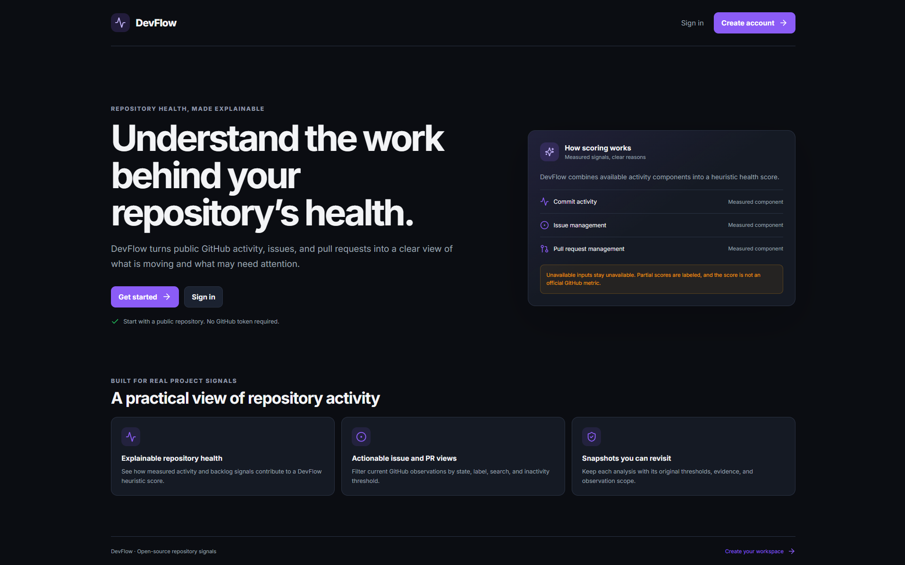
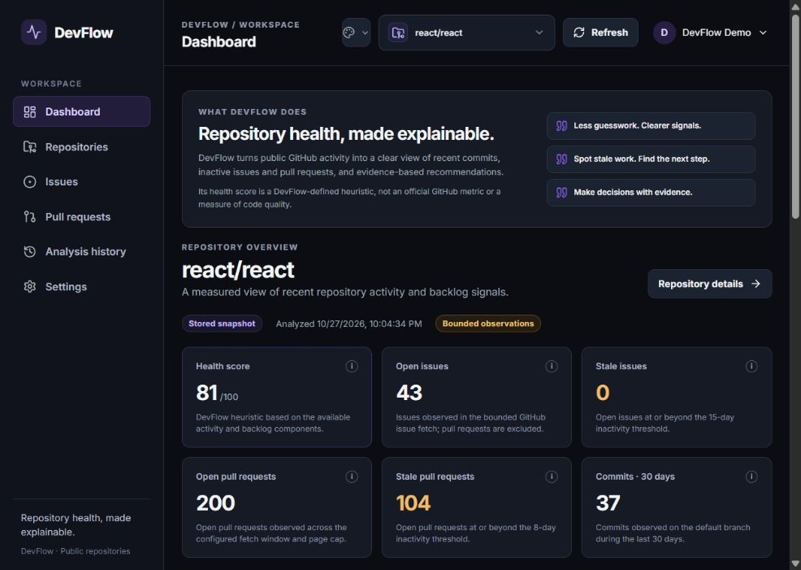
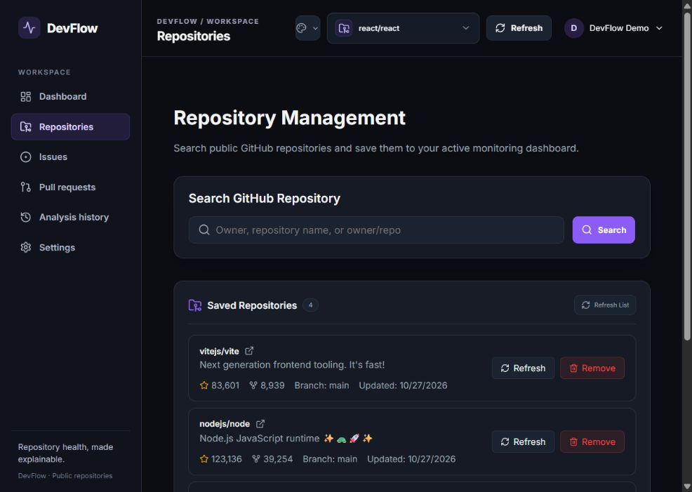
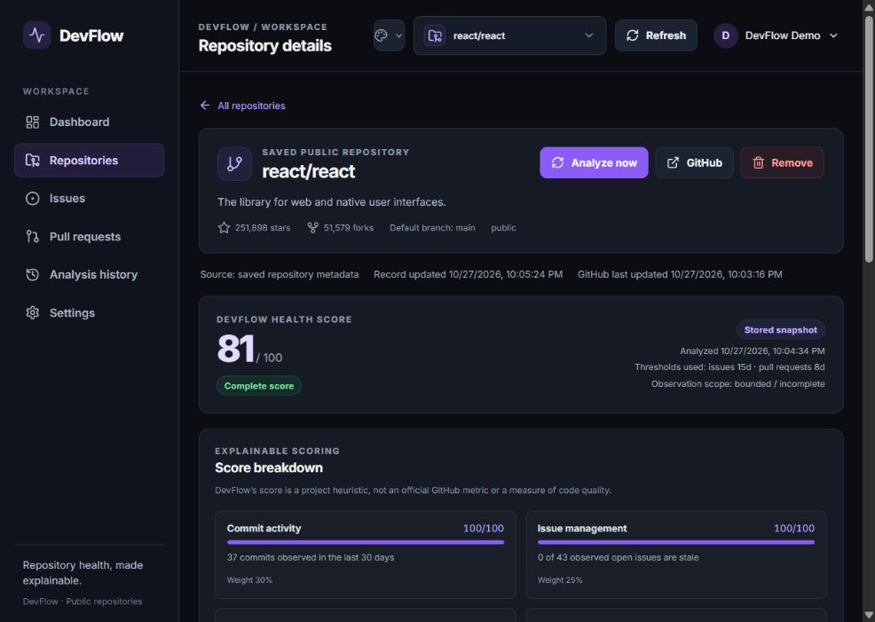
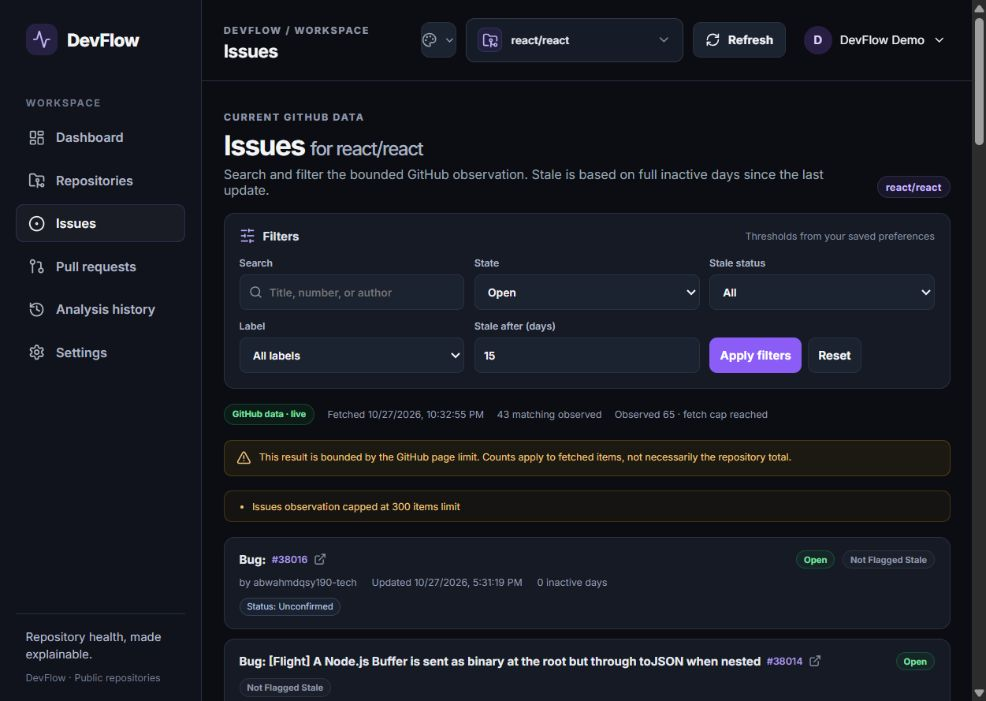
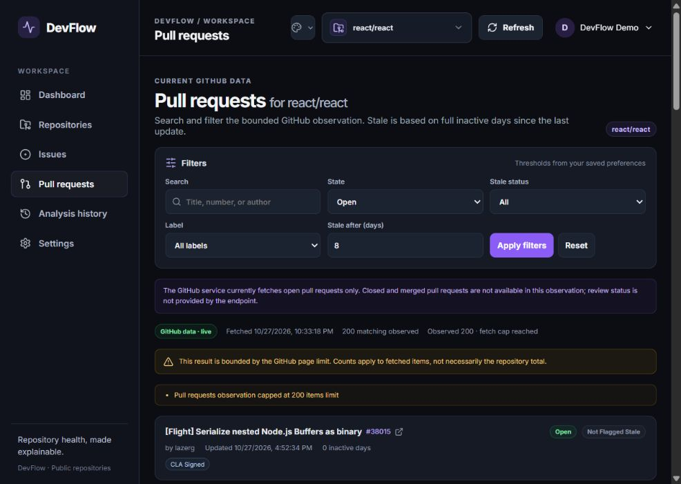
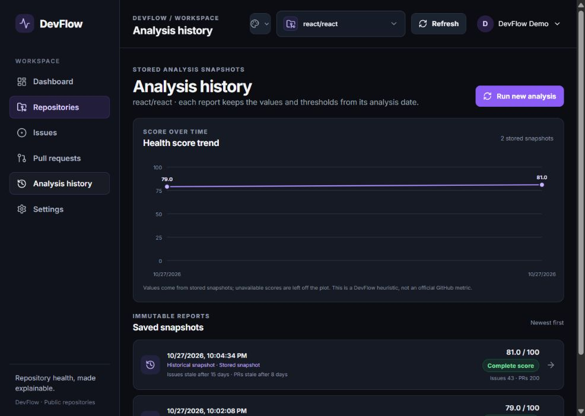
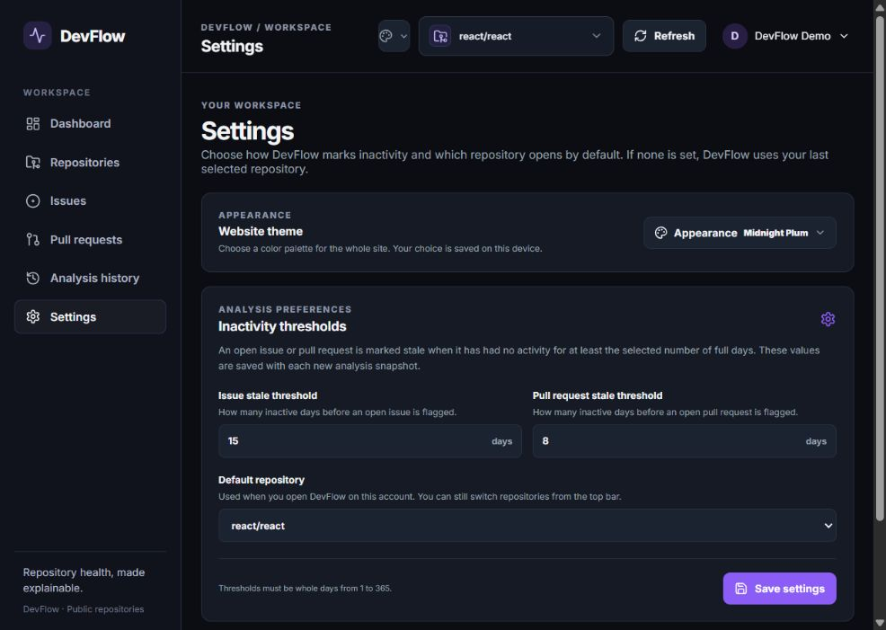
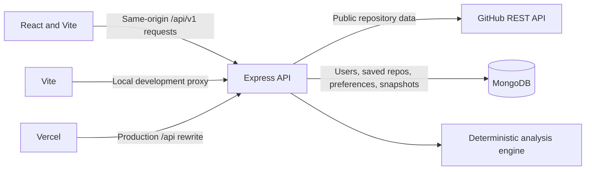

# DevFlow

**Understand your repositories. Identify risks. Make better engineering decisions.**

DevFlow is a repository activity dashboard for public GitHub repositories. It fetches bounded GitHub data, computes an explainable health score and rule-based recommendations, flags inactive issues and open pull requests, and stores analysis snapshots in MongoDB. The score is a **DevFlow-defined heuristic**—not an official GitHub metric and not a measure of code quality.

## Project links

- Live application: `https://devflow-eight-tau.vercel.app/`
- Source repository: `https://github.com/yashvardhan25bcs10761-dot/DevFlow`
- Demo video: `https://drive.google.com/file/d/1ztlwR9BHb9HC4hBunz5wJNtMSJXYhR5A/view?usp=drive_link`
- Screenshots: see the [screenshots section](#screenshots).

## Screenshots

These screenshots were captured from the deployed DevFlow app using the signed-in demo workspace and live GitHub data.

### Landing page



### Dashboard



### Repositories



### Repository detail



### Issues



### Pull requests



### Analysis history



### Settings



## Problem and intended users

Repository activity is spread across commits, issues, and pull requests. DevFlow brings a bounded view of those signals into one place so maintainers and contributors can identify inactive work and understand why a recommendation or score was produced. It is intended for people reviewing the activity of public repositories, not for judging code quality, security, or an individual contributor.

## Features

- Register, log in, log out, and keep a session in an HttpOnly cookie.
- Search public repositories by exact `owner/repo`, owner, or repository name; save, refresh, and remove repositories from a personal workspace.
- Analyze a saved repository and persist an immutable snapshot with score explanations, thresholds, recommendations, warnings, and observation scope.
- View current or cached issues and open pull requests with search, state, stale, label, threshold, and pagination controls.
- See a per-repository dashboard, explainable score components, evidence-backed recommendations, and historical reports.
- Configure issue and pull request inactivity thresholds and a default repository.
- Choose a website color theme. The theme selection is stored in the browser on that device.
- Show missing or capped data as unavailable or bounded rather than implying that a partial observation is complete.

## Technology

- Frontend: React 18, Vite 6, React Router 6, Lucide React, plain CSS, and a custom SVG history trend chart.
- Backend: Node.js, Express 4, Mongoose 8, bcryptjs, JSON Web Tokens, cookie-parser, Helmet, CORS, express-rate-limit, and Zod.
- Tests: Vitest, Supertest, React Testing Library, jsdom, and mongodb-memory-server.
- Persistence: MongoDB. GitHub is queried through its REST API by the backend only.

## Architecture



`frontend/src/services/api.js` sends same-origin API requests with credentials. In development, Vite proxies `/api` to `http://localhost:5000`. In production, `frontend/vercel.json` rewrites `/api/*` to the configured backend service and sends other paths to the SPA entry point. `backend/services/githubService.js` is the module that makes GitHub HTTP requests. The pure analysis functions are in `backend/services/engine/`. MongoDB stores user data and compact snapshots; historical reports render saved values and are not recalculated from current GitHub data.

## Repository structure

```text
DevFlow/
├── backend/
│   ├── config/       # Environment, MongoDB, and GitHub fetch configuration
│   ├── controllers/  # Auth, repository, analysis, preferences, work items
│   ├── middleware/   # Authentication, validation helpers, errors, rate limiting
│   ├── models/       # User, repository, preference, analysis schemas
│   ├── routes/       # Versioned API routes
│   ├── services/     # GitHub API, cache, normalization, analysis engine
│   ├── tests/        # Vitest and Supertest coverage
│   ├── validators/   # Zod request schemas
│   ├── .env.example
│   └── server.js
├── frontend/
│   ├── src/components/
│   ├── src/contexts/
│   ├── src/pages/
│   ├── src/services/
│   ├── tests/
│   ├── .env.example
│   ├── vercel.json
│   └── vite.config.js
├── package.json
├── package-lock.json
├── SPEC.md
└── README.md
```

## Data model overview

| Model | Stored information |
| --- | --- |
| User | Name, normalized unique email, password hash, timestamps. The hash is excluded from JSON responses. |
| Repository | Owner and repository names, GitHub ID, description, URL, visibility, default branch, stars/forks, GitHub timestamps, most recent analysis metadata, and owning user ID. The compound `{ userId, fullName }` index prevents duplicate saves for one user. |
| UserPreference | Per-user issue/PR stale thresholds (defaults 14 and 7 days; range 1–365) and optional default repository. |
| Analysis | One immutable record per run: score/status/breakdown, measured summaries, up to 50 stale issues and 50 stale PRs, up to 20 recommendations, thresholds, warnings, observation scope, and timestamps. |

## GitHub data bounds and caching

The backend uses the GitHub REST API with a backend-only `GITHUB_TOKEN`, a 10-second request timeout, and up to two retries for network errors or GitHub 5xx responses. Rate-limit responses are not retried. An in-memory cache has a five-minute TTL and a 100-entry maximum; refresh requests can bypass it. Cache contents are lost when the backend restarts.

| Data | Request bound | Meaning |
| --- | --- | --- |
| Repository metadata | One request | Latest metadata returned by GitHub. |
| Commits | One page of up to 100 from the last 30 days | 100 returned is reported as `100+`; the repository total is not inferred. |
| Issues | Up to 3 pages × 100 (300 items) | Pull requests returned by the issues endpoint are removed from the issue list. |
| Pull requests | Up to 2 pages × 100 (200 items) | Only open pull requests are fetched. |

If a fetch reaches its cap, the response and report indicate bounded or incomplete observations. Counts from a capped fetch describe the fetched items, not necessarily the repository-wide total. Source (`live` or `cached`) and fetch time are included where available.

## Health score

Each component score is clamped to 0–100. Weights are `commits: 0.30`, `issues: 0.25`, `pull requests: 0.25`, and `resolution: 0.20`.

| Component | Formula and availability |
| --- | --- |
| Commit activity | `min(100, round(commits30d / 20 * 100))`. Twenty or more observed commits in the last 30 days saturate this component at 100. A known zero is a score of 0 with a “no commits observed” explanation; failed/unavailable commit data is `null`. |
| Issue management | `round(100 * (1 - staleOpenIssues / observedOpenIssues))`. Unavailable (`null`) when there are no observed open issues to evaluate. |
| Pull request management | `round(100 * (1 - staleOpenPRs / observedOpenPRs))`. Unavailable (`null`) when there are no observed open PRs to evaluate. |
| Resolution activity | If `created30d > 0`: `round(100 * min(1, closed30d / created30d))`. If no issues were created but one or more were closed: 100. If both counts are zero: `null`. The calculation uses observed issues and may be marked as a partial window if the fetch cap cuts the window short. |

The overall score uses only available components:

```text
availableWeight = sum(weight for each available component)
healthScore = round(sum(componentScore * componentWeight) / availableWeight)
```

All four components available means **Complete score**. If fewer than four are available and `availableWeight >= 0.55`, the result is **Partial score**. Below 0.55, the result is **Insufficient data** and the overall score is `null`. Missing data is never silently scored as zero. Each component includes its weight and a human-readable explanation.

## Stale detection

For a valid `updatedAt` timestamp:

```text
inactivityDays = max(0, floor((now - updatedAt) / 86,400,000))
isStale = state is open AND inactivityDays >= thresholdDays
```

The threshold boundary is inclusive: exactly the configured number of full inactive days is stale. Closed items are not stale. Draft pull requests are assessed by the same inactivity rule. Missing or invalid timestamps are not marked stale and produce a data warning. GitHub's `updatedAt` also changes for comments, label changes, and other activity, so staleness is only an inactivity heuristic.

## Recommendations

Recommendations are deterministic, sorted by severity (high, medium, low, info), then by rule ID, and include measured evidence and a suggested action.

| Rule | Trigger | Severity |
| --- | --- | --- |
| R1 — stale issues | At least one observed open issue is stale. | High when at least 50% of observed open issues are stale; otherwise medium. |
| R2 — stale pull requests | At least one observed open PR is stale. | High when at least 50% of observed open PRs are stale; otherwise medium. |
| R3 — no recent commits | Zero commits were observed in the last 30 days. | Medium. |
| R4 — backlog growth | `observedOpenIssues >= 5` and `closed30d + 1 < created30d / 2`. | Medium. |
| R5 — partial data | Score is not complete, observation scope is incomplete, or data warnings exist. | Info. |

Recommendations are based only on measured observations. DevFlow does not scan for vulnerabilities and does not determine code quality.

## API

Base path: `/api/v1`. Responses use `{ success, data, message }` on success and `{ success: false, error }` on failure. All repository and analysis routes require authentication except the health endpoint and public landing/login/register pages. Repository and analysis reads/deletes are scoped to the authenticated user.

| Method | Path | Behavior |
| --- | --- | --- |
| `GET` | `/health` | API health, process uptime, and MongoDB readiness; returns 503 when the database is unavailable. |
| `POST` | `/auth/register` | Creates an account; requires name, valid email, and password of at least 8 characters including a letter and number. |
| `POST` | `/auth/login` | Verifies credentials and sets the session cookie. |
| `POST` | `/auth/logout` | Clears the session cookie. |
| `GET` | `/auth/me` | Returns the authenticated safe user profile. |
| `GET` | `/repositories/search?q=...&page=...` | Exact `owner/repo` lookup returns one public repository. A single owner or repo-name query returns paginated public matches; pages 1–10 are accepted. Includes source/fetch time. |
| `GET` | `/repositories` | Lists the authenticated user's saved repositories. |
| `POST` | `/repositories` | Saves `{ fullName: "owner/repo" }` after the backend fetches GitHub metadata; duplicate saves return 409. |
| `GET` | `/repositories/:id` | Reads an owned repository. |
| `DELETE` | `/repositories/:id` | Deletes an owned repository and its analysis snapshots. |
| `POST` | `/repositories/:id/refresh` | Refreshes metadata from GitHub. |
| `POST` | `/repositories/:id/analyze` | Fetches bounded data, calculates the score, stores a snapshot, and updates the repository's latest-analysis fields. |
| `GET` | `/repositories/:id/latest-analysis` | Reads the stored latest report. |
| `GET` | `/repositories/:id/analysis-history?page&limit` | Reads paginated snapshots, newest first. |
| `GET` | `/analyses/:id` | Reads an owned historical snapshot. |
| `GET` | `/repositories/:id/issues?state&stale&threshold&page&limit&label&search` | Filters current/cached issue observations. Supports all/open/closed issue state. |
| `GET` | `/repositories/:id/pull-requests?state&stale&threshold&page&limit&label&search` | Filters current/cached open PR observations. Closed/merged PRs and review status are not returned by the current integration. |
| `GET`, `PATCH` | `/preferences` | Reads or updates thresholds and an optional owned default repository. |

Common status codes include 400 validation, 401 unauthenticated, 404 missing or unowned resource, 409 duplicate save/email, 429 GitHub or authentication rate limit, and 502/503 upstream or database unavailable. The API validates ObjectIds and request data, limits JSON bodies to 10 KB, and rate-limits login and registration to 10 attempts per IP per 15 minutes outside test mode.

## Environment variables

Copy the example files and fill in local values. The backend requires `MONGODB_URI`, `JWT_SECRET`, and `GITHUB_TOKEN` at startup. Never commit `.env` files. The frontend `VITE_*` variables are embedded in the browser build; do not put secrets in them.

### Backend: `backend/.env`

| Variable | Purpose | Local default / note |
| --- | --- | --- |
| `NODE_ENV` | Runtime mode | `development` locally; `production` in deployment. |
| `PORT` | HTTP listening port | Defaults to `5000`; server listens on `0.0.0.0`. |
| `MONGODB_URI` | MongoDB connection | Required. Configure the URI for the `devflow` database. |
| `JWT_SECRET` | Signs session JWTs | Required. Use a long random value. |
| `CLIENT_URL` | Allowed CORS origin | Defaults to `http://localhost:5173`. |
| `GITHUB_TOKEN` | GitHub REST API access | Required, backend-only; use the least-privileged token that can read public repository data. |
| `BCRYPT_ROUNDS` | Password hashing cost | Defaults to `12`. |

### Frontend: `frontend/.env`

| Variable | Purpose | Default |
| --- | --- | --- |
| `VITE_API_URL` | Present in the frontend example file as the intended API base path | `/api/v1`; current source uses relative `/api/v1` paths directly and does not read this variable. |

The frontend currently makes same-origin `/api/v1` requests directly; `VITE_API_URL` is in `.env.example` but is not consumed by the current source. Do not put GitHub, MongoDB, or JWT secrets in frontend variables.

## Local setup

Prerequisites: Node.js 20 or later, npm, and a reachable MongoDB instance or Atlas database. GitHub access requires a personal/fine-grained token with public repository read access. Add values to `backend/.env` locally before starting the API. The guarded copy commands below leave existing `.env` files untouched.

### Windows PowerShell

Run from the repository root. These guarded copy commands do not overwrite existing `.env` files:

```powershell
if (!(Test-Path backend/.env)) { Copy-Item backend/.env.example backend/.env }
if (!(Test-Path frontend/.env)) { Copy-Item frontend/.env.example frontend/.env }
```

### macOS / Linux and common npm commands

From the repository root, create each local `.env` file only if it is missing, then run the common npm commands. The Node command for copying examples works in PowerShell and POSIX shells:

```sh
node -e "const fs=require('node:fs'); for (const p of ['backend/.env','frontend/.env']) if (!fs.existsSync(p)) fs.copyFileSync(p+'.example',p)"
npm install
npm run dev
```

Set `MONGODB_URI`, `JWT_SECRET`, and `GITHUB_TOKEN` in `backend/.env` before starting the API. Vite defaults to `http://localhost:5173` (and uses the next free port if 5173 is occupied); the backend defaults to port 5000. Vite proxies API requests to the backend. The API health route is `/api/v1/health` on port 5000; it reports database readiness.

## MongoDB Atlas setup

1. Create an Atlas project and cluster for DevFlow.
2. Create a database user with the `readWrite` role scoped to the `devflow` database; do not reuse your Atlas account password.
3. Add the development machine's public IP under **Security → Network Access**.
4. Copy the connection string, select the `devflow` database, URL-encode special characters in the database password as required by MongoDB, and store the URI only in `backend/.env` or the backend host's secret environment variables.
5. For deployment, configure the network rule required by the selected Render plan and current Render outbound-IP behavior. If a plan cannot provide stable outbound IPs, a broad `0.0.0.0/0` rule may be required; it accepts connections from any IP. Use a unique long database password, restrict the database user to this app's database, and choose a narrower network rule if your plan supports one.

Automated tests use mongodb-memory-server and mocked GitHub responses; they do not connect to Atlas or GitHub. The test binary may need to be downloaded on the first backend test run.

## Tests and production build

Run from the repository root:

```sh
npm test
npm run build
```

`npm test` runs the backend Vitest/Supertest suite followed by frontend Vitest/React Testing Library tests. Backend tests use an in-memory MongoDB process. Frontend tests run in jsdom. `npm run build` runs the Vite production build. The package scripts do not currently define a lint command.

## Deployment

The checked-in frontend deployment configuration is `frontend/vercel.json`. Replace its API rewrite destination with your Render service URL before deploying; the second rewrite sends SPA routes to `/index.html`. Keep the real service URL in deployment configuration only after you create your own service.

### Render backend

Create a Render Web Service from the source repository with:

- Root directory: `backend`
- Build command: `npm install`
- Start command: `npm start`
- Health check path: `/api/v1/health`
- Environment: `NODE_ENV=production`, `PORT` supplied by Render, `CLIENT_URL=https://<YOUR-VERCEL-DOMAIN>`, plus `MONGODB_URI`, `JWT_SECRET`, `GITHUB_TOKEN`, and optionally `BCRYPT_ROUNDS`.

The backend loads its environment from the process environment in deployment. `PORT` defaults to 5000 if not supplied and the server binds to `0.0.0.0`.

### Vercel frontend

Create a Vercel project from the same repository with:

- Root directory: `frontend`
- Build command: `npm run build`
- Output directory: `dist`
- No frontend API environment variable is required by the current source; requests use relative `/api/v1` paths. `frontend/.env.example` includes `VITE_API_URL=/api/v1`, but the current code does not read it.

Set the rewrite destination in `frontend/vercel.json` to `https://<YOUR-RENDER-SERVICE>.onrender.com/api/:path*`, deploy the frontend, then set Render's `CLIENT_URL` to the resulting Vercel origin and redeploy the backend if needed. Test registration/login, a repository search/save/analyze flow, and `/api/v1/health` after deployment. Do not publish secret values in this README.

## Security notes

- JWT session cookies are HttpOnly, SameSite=Lax, seven days, and Secure when `NODE_ENV=production`.
- Passwords are hashed with bcryptjs; password hashes are removed from serialized user documents.
- GitHub tokens and MongoDB credentials belong only in backend environment variables. Do not expose them in frontend builds, logs, screenshots, or commits.
- Authentication endpoints are rate-limited. JSON request bodies are capped at 10 KB. Helmet adds security headers.
- Repository and analysis operations are scoped to the authenticated user. Production server errors do not return stack traces. The health endpoint exposes database readiness and uptime, not credentials.
- A wide Atlas IP allowlist such as `0.0.0.0/0` weakens network restriction; only use it if required by the selected host/network plan and offset it with a dedicated least-privilege DB user and strong unique password.

## Known limitations

- Only public GitHub repositories are supported. There is no GitHub OAuth connection, private-repository access, or multi-account GitHub authorization.
- GitHub data is bounded to 100 commits, 300 issues, and 200 open pull requests per analysis. Capped data is marked incomplete and is not a full repository total.
- The current pull request integration fetches open PRs only. Closed/merged PRs and review state are unavailable; DevFlow does not infer approval status.
- GitHub's `updatedAt` field changes on comments, labels, and other activity, so stale detection approximates inactivity.
- Repository renames and transfers are not automatically reconciled with saved records.
- The GitHub cache is in memory, lasts five minutes, and is cleared when the backend process restarts.
- GitHub rate limits, network outages, Atlas connectivity, and host availability can delay or prevent data retrieval. A Render free instance may sleep while idle, so its first request can be slow.
- Analysis is an explainable activity heuristic, not a code-quality rating, security scan, vulnerability detector, or guarantee about project health.

## Future work

Possible extensions after the public-repository MVP include GitHub OAuth and explicit account permissions, private-repository access, repository comparisons, data export, configurable cache controls, scheduled analysis, and team views. These are not implemented features.
